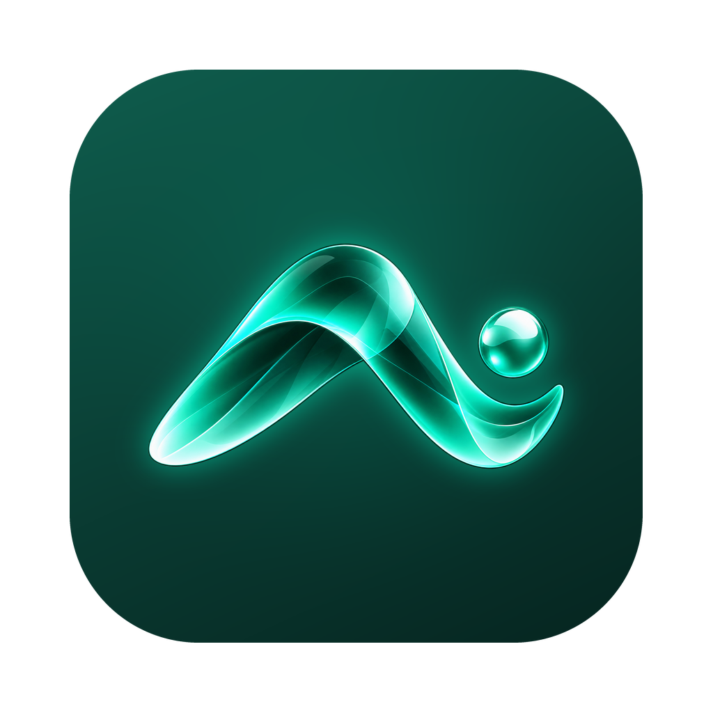

  
  <h1>MOOPI Desktop</h1>
  
<b>Biznes egasining shaxsiy AI yordamchisi — endi kompyuterda.</b> 
  Личный ИИ-помощник владельца бизнеса — теперь на компьютере.

  
<a href="https://moopi.uz">moopi.uz</a> · <a href="https://t.me/moopiai">@moopiai</a>

---

**MOOPI** — O'zbekiston biznes egalari uchun shaxsiy sun'iy intellekt yordamchi: biznesingizni o'rganadi,
har kuni ertalab reja tuzadi, Telegram va Instagram'da mijozlarga javob tayyorlaydi, daftar yuritadi, hujjat
va taqdimot qiladi. **MOOPI Desktop** — shu yordamchining kompyuter uchun ilovasi: o'rtada MOOPI, yonida
Claude (foydalanuvchi o'z Claude obunasi bilan kiradi).

Bu ombor — MOOPI Desktop'ning qobig'i va qurilish jarayoni. Ilovaning o'zi, uning aqli, xotirasi va
integratsiyalari MOOPI serverida ishlaydi va bu yerda emas.

## Yuklab olish / Скачать

- **Windows** — [oxirgi nashr](https://github.com/mnekboyev99-1/moopi-desktop-build/releases/latest):
  `MOOPI-DesktopUserSetup-x64-<versiya>.exe` (oddiy kompyuterlar), `...-arm64-...` (ARM noutbuklar).
- **Mac** — tez kunda.

O'rnatilgan dastur o'zini yangilab turadi.

## Texnik asos

MOOPI Desktop [VSCodium](https://github.com/VSCodium/vscodium) (Microsoft'ning ochiq kodli
[Code - OSS](https://github.com/microsoft/vscode) yig'ilmasi, MIT litsenziyasi) asosida qurilgan; Anthropic'ning
rasmiy Claude Code kengaytmasi o'zgartirilmasdan ishlatiladi, har foydalanuvchi o'z Claude hisobi bilan kiradi
([Anthropic shartlari](https://code.claude.com/docs/en/legal-and-compliance)). Claude nomi va logosi Anthropic'ga
tegishli. Qurilish: GitHub Actions, `publish-stable-windows` ish oqimi.

## Asoschi / Основатель

**Muxiddin Nekbayev** — MOOPI'ning asoschisi va muallifi (Toshkent, O'zbekiston). · [GitHub](https://github.com/mnekboyev99-1)

© 2026 MOOPI · Muxiddin Nekbayev. MOOPI nomi va logosi — mualliflik huquqi bilan himoyalangan; qobiqning kodi
VSCodium va Code - OSS litsenziyalari bo'yicha ([LICENSE](./LICENSE)).
